<div align="center">

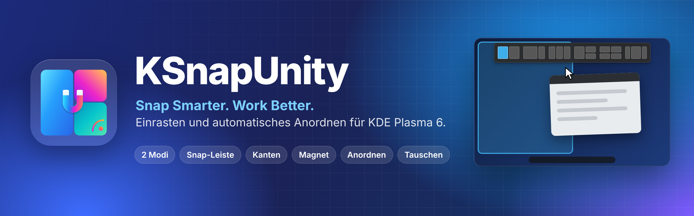

# KSnapUnity

🇬🇧 [English](README.md) · 🇩🇪 Deutsch

### Snap Smarter. Work Better.

**2 Modi, 6 Funktionen: smartes Einrasten und automatisches Anordnen für KDE Plasma 6 – in einem KWin-Script.**

Zieh ein Fenster an den oberen Rand und leg es auf einer Zone der Snap-Leiste ab – oder lass jedes Fenster seinen Platz von selbst finden. Eine Taste (`Strg`+`Alt`+`A`) wechselt zwischen beiden Welten.

[](LICENSE)


[Video](#-das-intro-ansehen) · [Zwei Modi](#-zwei-modi) · [Funktionen](#-sechs-funktionen) · [Automatisch anordnen](#-automatisch-anordnen) · [Tastenkürzel](#%EF%B8%8F-tastenkürzel) · [Installation](#-installation) · [Einstellungen](#%EF%B8%8F-einstellungen) · [FAQ](#-probleme--faq)

<br>


</div>

---

## 🎬 Das Intro ansehen

<div align="center">


https://github.com/user-attachments/assets/625b5630-7e4a-4024-bd61-137414b49925


<sub>45 Sekunden · Snap-Leiste, Moduswechsel, automatisches Anordnen, Tauschen und der Einstellungseditor</sub><br>
<sub>🇬🇧 <a href="docs/video/ksnapunity-intro-en.mp4">Englische Version</a></sub>

</div>

---

## 🧩 Wofür steht U.N.I.T.Y.?

**K** für KWin · **Snap** für smarteres Einrasten · **Unity** für alles in einem System:

| | | |
|:-:|---|---|
| **U** | **Unified** | Alle Fensterfunktionen in einem System. |
| **N** | **Natural** | Intuitives, natürliches Fensterverhalten. |
| **I** | **Intelligent** | Kluges Anordnen und Erkennen. |
| **T** | **Tiling** | Snap-Layouts und automatisches Anordnen. |
| **Y** | **Your Workflow** | Passt sich deiner Arbeitsweise an. |

Ein reines KWin-Script: kein Zusatzprogramm, kein Hintergrunddienst, nichts zu kompilieren.

---

## 🔀 Zwei Modi

Einrasten von Hand und automatisches Anordnen würden sich gegenseitig stören – deshalb laufen sie als **zwei Modi**. Drück **`Strg`+`Alt`+`A`**, klick im Editor auf „Modus wechseln“ oder nutz den Schalter in den Quick-Einstellungen.

| | Modus 1 – Snap-Leiste & Bildschirmkanten | Modus 2 – Automatisch anordnen |
|---|---|---|
| **Idee** | Du bestimmst, wo ein Fenster hinkommt | Jedes Fenster bekommt seinen Platz von selbst |
| **Snap-Leiste** | ✅ | – |
| **Bildschirmkanten** | ✅ | – |
| **Fenster-Magnet** | ✅ | ✅ für freie Fenster |
| **Tastenkürzel** | ✅ Einrast-Tasten | ✅ Anordnen-Tasten, Pfeile schieben ein Fenster auf den Platz des Nachbarn |
| **Fenster tauschen** | ✅ über der Mitte eines anderen Fensters loslassen | ✅ irgendwo über einem anderen Fenster loslassen |

Beide Modi gibt es nur, wenn *Automatisch anordnen* **und** die Snap-Leiste oder die Bildschirmkanten eingeschaltet sind. Sonst läuft nur das Eingeschaltete, und die Modus-Taste macht nichts.

---

## ✨ Sechs Funktionen

| | |
|---|---|
| 🪟 **Snap-Leiste** | Fenster an der Titelleiste zum oberen Rand ziehen. Eine Leiste mit Layouts fährt herunter; auf einer Zone ablegen, und das Fenster füllt genau diesen Bereich. Wieder wegziehen, und es bekommt seine alte Größe zurück. |
| ⇲ **Bildschirmkanten** | Fenster gegen eine Kante oder Ecke drücken: maximieren, Hälften, untere Hälfte, Viertel. Etwas länger halten, und es wächst bis zum nächsten Fenster. |
| 🧲 **Fenster-Magnet** | Kanten haften an anderen Fenstern und an den Bildschirmrändern – auch bei schnellen Bewegungen. Gemeinsame Kanten ändern die Größe zusammen (klebende Kanten). Maus schütteln oder weiterdrücken zum Lösen. |
| ⌨️ **Tastenkürzel** | Hälften, Viertel, Drittel, maximieren, zentrieren, tauschen und alle Anordnen-Aktionen – jede Taste direkt im Editor änderbar. |
| 🧱 **Automatisch anordnen** | Wie Krohnkite oder Polonium: Haupt und Stapel, Spalten, Raster, Spirale, Dwindle … oder **deine eigenen Layouts**. Fenster gleiten sanft an ihren Platz. |
| ⇄ **Fenster tauschen** | Ein Fenster auf ein anderes ziehen – sie tauschen die Plätze. Oder `Strg`+`Alt`+`Umschalt`+Pfeil drücken. |

Jede Funktion lässt sich einzeln ein- und ausschalten – in der Seitenleiste des Einstellungseditors oder in den Quick-Einstellungen.

<table>
<tr>
<td width="50%">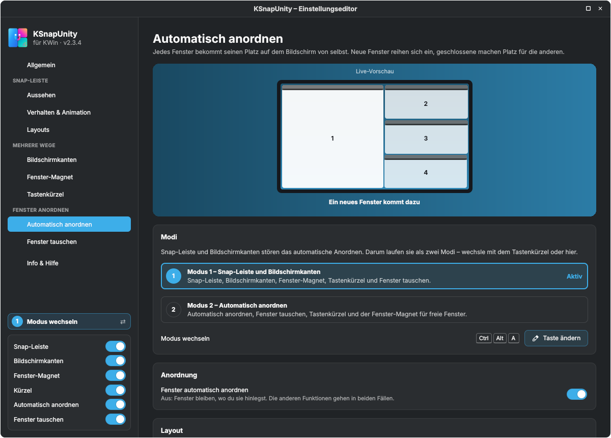</td>
<td width="50%">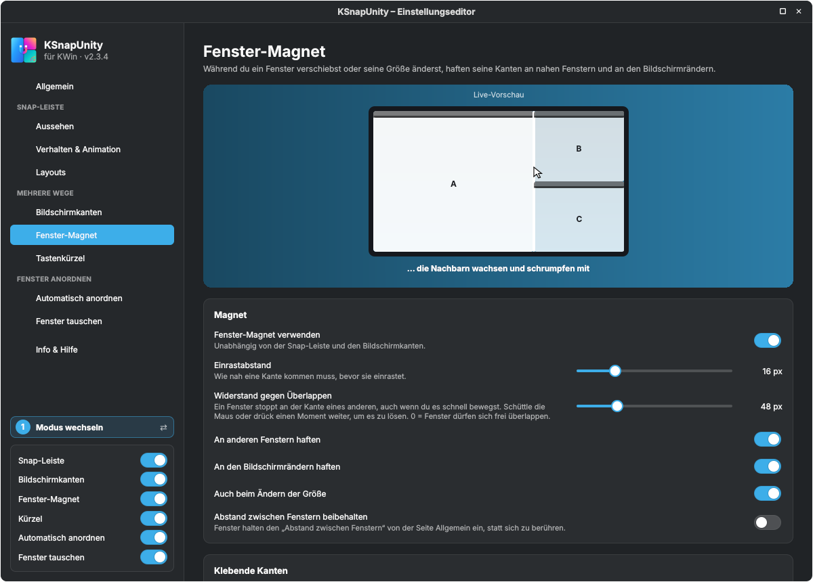</td>
</tr>
<tr>
<td align="center"><sub>Automatisch anordnen – mit animierter Live-Vorschau</sub></td>
<td align="center"><sub>Fenster-Magnet – klebende Kanten in Aktion</sub></td>
</tr>
<tr>
<td width="50%">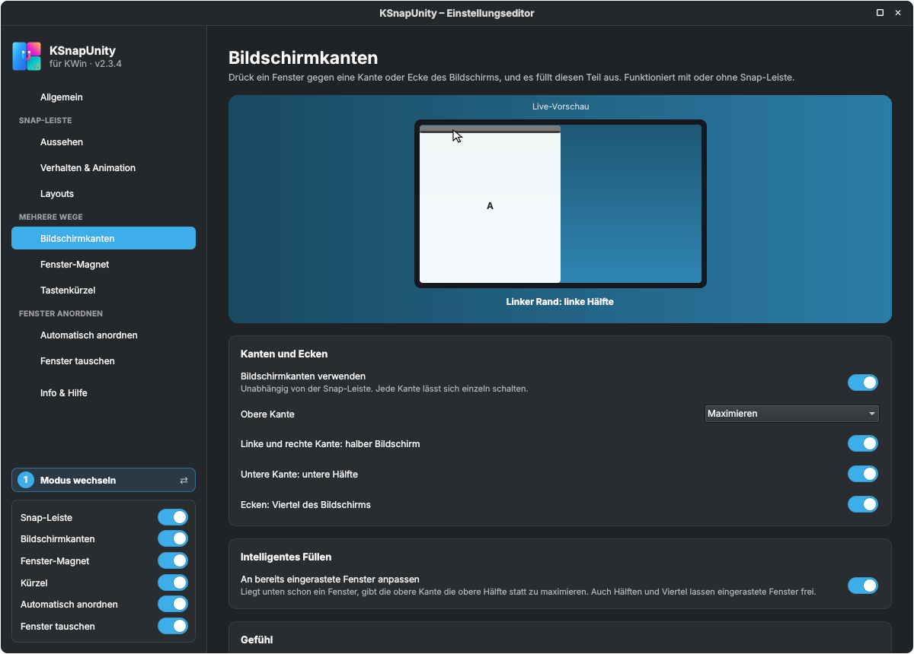</td>
<td width="50%">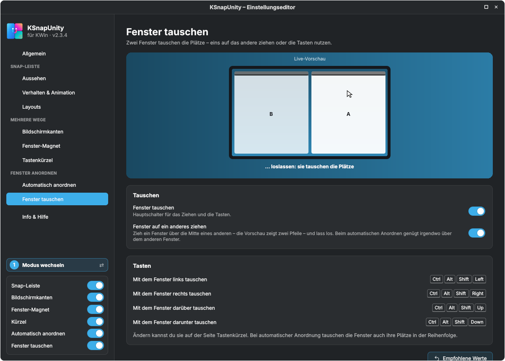</td>
</tr>
<tr>
<td align="center"><sub>Bildschirmkanten</sub></td>
<td align="center"><sub>Fenster tauschen</sub></td>
</tr>
</table>

---

## 🧱 Automatisch anordnen

Das Beste aus Krohnkite und Polonium, in einem Einstellungseditor zum Durchklicken:

- **Layouts:** Haupt und Stapel, Haupt in der Mitte, Spalten, Zeilen, Raster, Spirale, Dwindle, eins nach dem anderen – **plus jedes Layout aus deinem Layout-Baukasten**. Fenster 1 bekommt die größte Zone, weitere Fenster teilen sich die letzte; mit weniger Fenstern als Zonen wird *Haupt und Stapel* benutzt, damit keine Löcher entstehen.
- **Layout nach Anzahl der Fenster:** z. B. zwei Fenster nebeneinander, ab drei Haupt und Stapel, ab fünf ein Raster (bis zu 6 Regeln, optional).
- **Hauptbereich:** Größe (auch per Ziehen an der Kante des Hauptfensters), Anzahl der Hauptfenster, Hauptbereich links oder rechts.
- **Neue Fenster** kommen ans Ende, nehmen den Hauptplatz oder öffnen sich neben dem aktiven Fenster.
- **Ein einzelnes Fenster** kann schmaler in der Mitte stehen – ideal für breite Bildschirme – und den Außenabstand ignorieren.
- **Animation:** Fenster gleiten an ihren Platz statt zu springen; ein neues oder wiederhergestelltes Fenster erscheint direkt an seinem Platz.
- **Immer schwebend:** geöffnete Programme auswählen, die nie angeordnet werden. Dialoge schweben immer.
- **Fenster schließen – keine Lücke.** Minimieren, schließen oder schweben lassen, und die anderen füllen den Platz sofort.

<details>
<summary><b>Anordnen-Tasten</b></summary>

| Taste | Aktion |
|---|---|
| `Strg`+`Alt`+`N` | Nächstes Layout |
| `Strg`+`Alt`+`M` | Zum Hauptfenster machen |
| `Strg`+`Alt`+`O` | Fenster schweben lassen (aus der Anordnung nehmen) |
| `Strg`+`Alt`+`.` / `,` | Hauptbereich größer / kleiner |
| `Strg`+`Alt`+`]` / `[` | Ein Hauptfenster mehr / weniger |
| `Strg`+`Alt`+Pfeile | Fenster auf den Platz des Nachbarn schieben (Modus 2) |
</details>

---

## ⌨️ Tastenkürzel

Standard-Schema `Strg`+`Alt` (ein Ziffernblock-Schema ist ebenfalls dabei). Alle Tasten sind normale globale KDE-Kurzbefehle – ändern auf der Seite *Tastenkürzel* im Editor oder unter *Systemeinstellungen → Kurzbefehle → KWin*.

| Taste | Aktion |
|---|---|
| `Strg`+`Alt`+`A` | **Modus wechseln** (Einrasten ⇄ automatisch anordnen) |
| `Strg`+`Alt`+`←` `→` `↑` `↓` | Linke / rechte / obere / untere Hälfte |
| `Strg`+`Alt`+`U` `I` `J` `K` | Viertel (oben links, oben rechts, unten links, unten rechts) |
| `Strg`+`Alt`+`D` `F` `G` | Linkes / mittleres / rechtes Drittel |
| `Strg`+`Alt`+`E` `Y` | Linke / rechte zwei Drittel |
| `Strg`+`Alt`+`Eingabe` | Maximieren oder wiederherstellen |
| `Strg`+`Alt`+`C` | Fenster zentrieren |
| `Strg`+`Alt`+`-` | Größe von vor dem Einrasten wiederherstellen |
| `Strg`+`Alt`+`Umschalt`+Pfeile | Mit dem Nachbarfenster tauschen |
| `Strg`+`Alt`+`N` `M` `O` `.` `,` `]` `[` | Anordnen (siehe oben) |

---

## 🚀 Installation

**Voraussetzungen:** KDE Plasma 6 (KWin 6), Wayland oder X11, jede Distribution. Keine Abhängigkeiten.

**Weg A – KDE Store (am einfachsten)**

*Systemeinstellungen* → *Fensterverwaltung* → *KWin-Skripte* → **Neue holen …** → nach **KSnapUnity** suchen → **Installieren**. Haken setzen und **Anwenden** klicken.

**Weg B – Datei von GitHub**

1. **`ksnapunity-<version>.kwinscript`** von der Seite [**Releases**](../../releases/latest) herunterladen.
2. *Systemeinstellungen* → *Fensterverwaltung* → *KWin-Skripte* → **Aus Datei installieren …** → Datei wählen.
3. Haken bei **KSnapUnity** setzen und **Anwenden** klicken.

**Weg C – Terminal**

```bash
kpackagetool6 --type KWin/Script --install ksnapunity-2.3.4.kwinscript   # erste Installation
kpackagetool6 --type KWin/Script --upgrade ksnapunity-2.3.4.kwinscript   # Update
kwriteconfig6 --file kwinrc --group Plugins --key kdesnaplayoutEnabled true
qdbus6 org.kde.KWin /KWin reconfigure
```

**Weg D – aus dem Quellcode**

```bash
git clone https://github.com/SeaQSoft/KSnapUnity.git
cd KSnapUnity
bash build.sh        # → dist/ksnapunity-<version>.kwinscript
bash install.sh      # optional: saubere Installation zum Entwickeln
```

> [!IMPORTANT]
> KWin behält ein geladenes Script im Speicher. **Nach einem Update einmal ab- und wieder anmelden.** Die Version steht in der Seitenleiste des Einstellungseditors.

> [!NOTE]
> **Kommst du von SnapMagic, SeaQ Snap Layout oder KDE Snap Layout?** KSnapUnity ist dasselbe Script mit neuem Namen – die interne ID bleibt `kdesnaplayout`, ein Update behält also deine Einstellungen, Layouts und Tasten.

<details>
<summary><b>Deinstallieren</b></summary>

```bash
kpackagetool6 --type KWin/Script --remove kdesnaplayout
rm ~/.config/kde-snaplayout.ini      # optional: Einstellungen und Layouts löschen
```
</details>

---

## ⚙️ Einstellungen

### Quick-Einstellungen

*Systemeinstellungen* → *Fensterverwaltung* → *KWin-Skripte* → **Zahnrad** neben *KSnapUnity*.

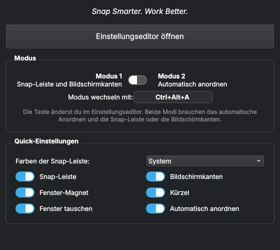

Modus umschalten, die Modus-Taste sehen, die Farben der Snap-Leiste wählen und jede Funktion ein- oder ausschalten. **Einstellungseditor öffnen** → **OK** öffnet den vollen Editor. Änderungen hier erscheinen im Editor und umgekehrt.

### Einstellungseditor

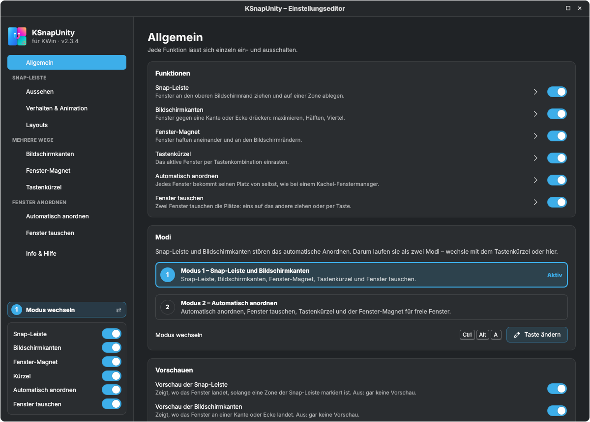

| Seite | Was du dort einstellst |
|---|---|
| **Allgemein** | Alle Funktionen auf einen Blick, Modi, Vorschauen, Abstände zwischen Fenstern und zum Bildschirmrand |
| **Aussehen** | Helle, dunkle oder Systemfarben, Akzentfarbe, Größe, Rundung, Layout-Namen |
| **Verhalten & Animation** | Wann die Leiste erscheint und verschwindet, Einfahr- und Ausblend-Animation, Bewegungskurve |
| **Layouts** | Reihenfolge und Sichtbarkeit der Layouts, **Layout-Baukasten** für eigene Layouts |
| **Bildschirmkanten** | Welche Kante was macht, intelligentes Füllen, Halten zum Füllen, KDEs eigenes Kanten-Kacheln |
| **Fenster-Magnet** | Einrastabstand, Widerstand, klebende Kanten, auch beim Größe-Ändern |
| **Tastenkürzel** | Jede Taste, Tasten-Schemata, Konflikte mit anderen Kurzbefehlen |
| **Automatisch anordnen** | Layout, eigene Layouts, Layout nach Fensteranzahl, Hauptbereich, neue Fenster, einzelnes Fenster, Animation, immer schwebend |
| **Fenster tauschen** | Tauschen per Ziehen, Tausch-Tasten |
| **Info & Hilfe** | Version, U.N.I.T.Y., So funktioniert’s, Unterstützung |

Jede Funktionsseite hat eine **animierte Live-Vorschau**, die zeigt, was die Funktion macht – mit deinen Einstellungen.

<details>
<summary><b>Weitere Bilder</b></summary>

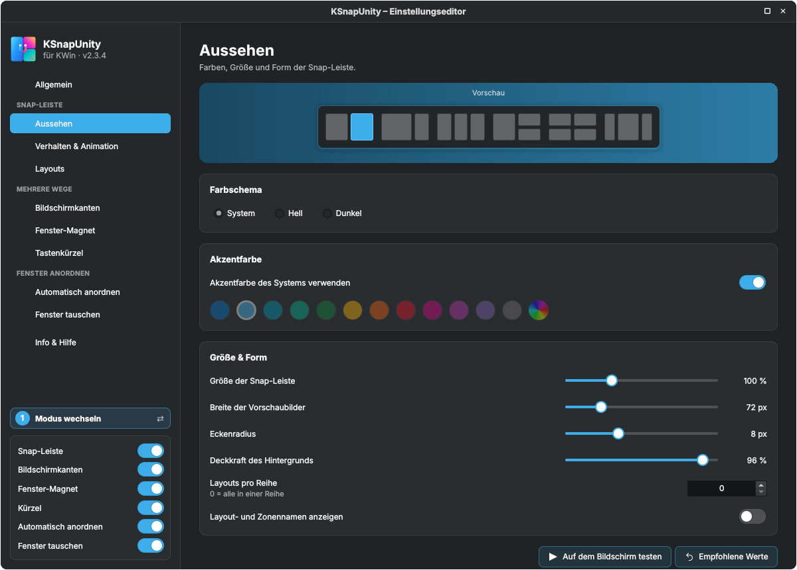
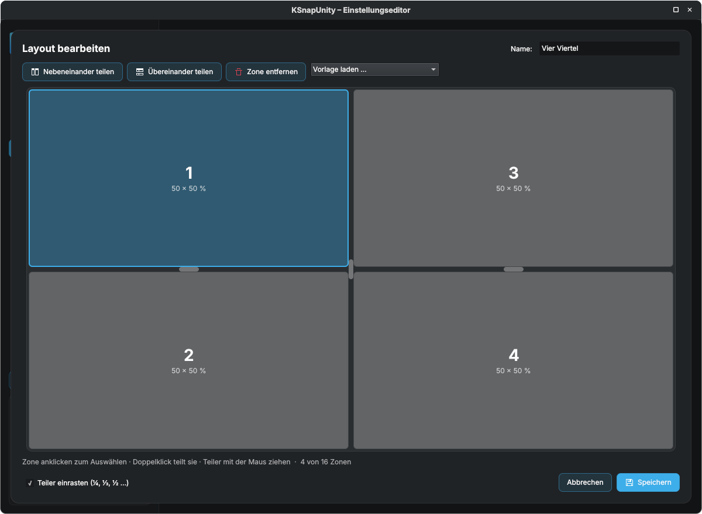
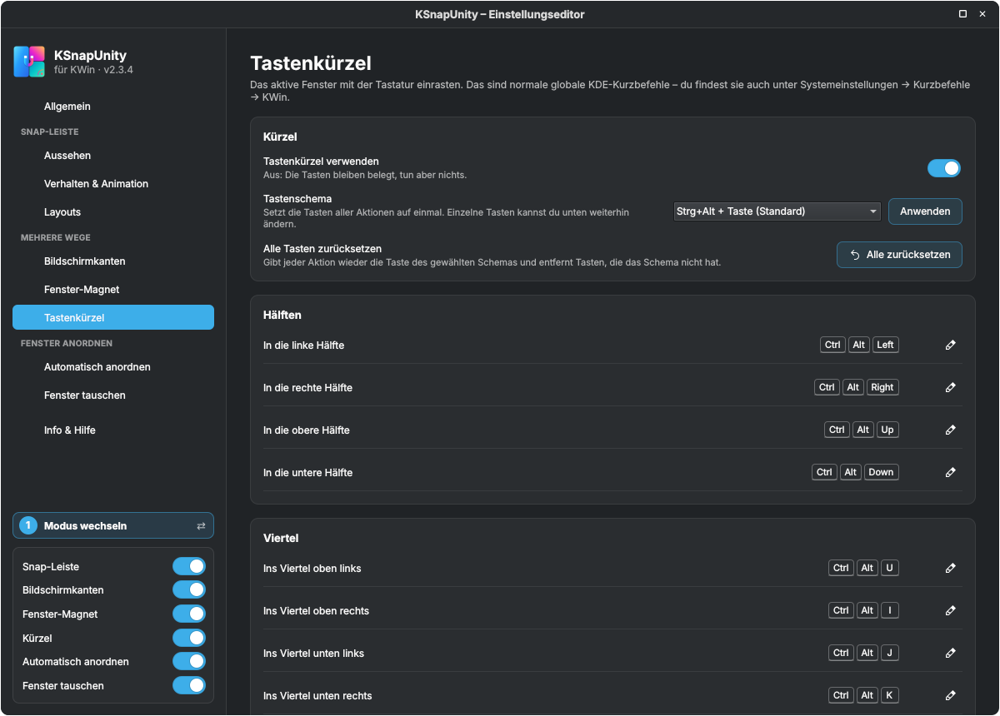
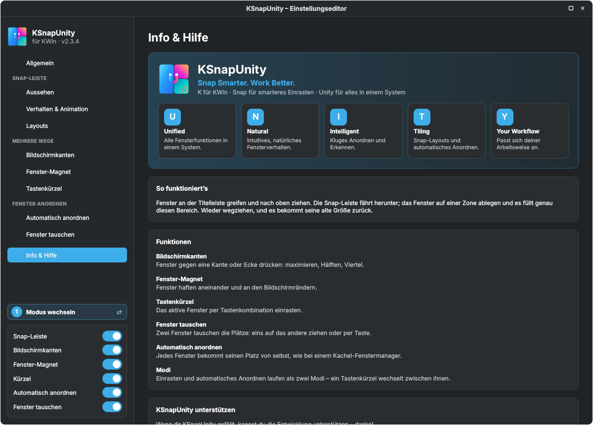
</details>

---

## 🗂️ Projektaufbau

```
KSnapUnity/
├── package/                    das KWin-Script (das, was installiert wird)
│   ├── metadata.json
│   └── contents/
│       ├── ui/                 main.qml (Logik), SnapBar, SettingsPage, Tiler, LiveDemo, config.ui, …
│       ├── code/               layouts.js, edges.js, tiling.js, keys.js, i18n.js, translations.js (erzeugt)
│       ├── config/main.xml     Optionen der Quick-Einstellungen (kwinrc)
│       ├── locale/             .mo-Dateien für die Quick-Einstellungen (erzeugt)
│       └── icons/
├── i18n/                       eine Textdatei pro Sprache + build.py / check.py
├── docs/                       Bilder, Videos, Texte für den KDE Store
├── README.md                   englische README
├── build.sh                    baut dist/ksnapunity-<version>.kwinscript
└── install.sh                  saubere Installation zum Entwickeln
```

---

## 🌍 Übersetzungen

Die Oberfläche folgt der Systemsprache. **62 Sprachen** sind enthalten: alle europäischen Sprachen, Chinesisch (vereinfacht und traditionell), Japanisch, Koreanisch, Hindi, Bengalisch, Tamil, Telugu, Marathi, Gujarati, Panjabi, Urdu, Arabisch, Hebräisch, Persisch, Indonesisch, Malaiisch, Vietnamesisch, Thai, Filipino, Georgisch, Armenisch und mehr.

Jede Sprache ist eine einfache Textdatei in [`i18n/`](i18n) mit einer Zeile pro Text, in der Reihenfolge von `i18n/master.txt`. Zum Verbessern die Datei bearbeiten und ausführen:

```bash
python3 i18n/check.py      # Zeilenzahl und Platzhalter prüfen
python3 i18n/build.py      # translations.js und .mo-Dateien neu erzeugen
```

Pull Requests mit Korrekturen oder neuen Sprachen sind sehr willkommen.

---

## ❓ Probleme & FAQ

<details>
<summary><b>Die Snap-Leiste erscheint nicht.</b></summary>

Prüfe, ob das Script unter *KWin-Skripte* angehakt ist, ob du in **Modus 1** bist und ob *Snap-Leiste* eingeschaltet ist. Das Fenster muss ein normales, größenveränderbares Fenster sein, das du an der Titelleiste ziehst.
</details>

<details>
<summary><b>Die Modus-Taste macht nichts.</b></summary>

Beide Modi brauchen *Automatisch anordnen* und die Snap-Leiste oder die Bildschirmkanten. Die Quick-Einstellungen zeigen, welche Taste gesetzt ist. Beim Update von einer älteren Version wandert die Taste einmal von `Strg`+`Alt`+`Leertaste` auf `Strg`+`Alt`+`A` – eine selbst gewählte Taste bleibt.
</details>

<details>
<summary><b>Das automatische Anordnen verschiebt ein Fenster, das bleiben soll, wo es ist.</b></summary>

Drück `Strg`+`Alt`+`O` (*Fenster schweben lassen (Anordnung verlassen)*) oder füge das Programm auf der Anordnen-Seite unter *Immer schwebend* hinzu.
</details>

<details>
<summary><b>Fenster lösen sich zu leicht voneinander – oder zu schwer.</b></summary>

Ändere *Widerstand gegen Überlappen* auf der Seite *Fenster-Magnet*. Zum gewollten Lösen die Maus schnell schütteln oder kurz weiterdrücken.
</details>

<details>
<summary><b>Beim Ziehen an eine Kante passieren zwei Dinge.</b></summary>

Plasmas eigenes Kanten-Kacheln oder seine Einrastzonen sind aktiv. Lass *KDEs Kanten-Kacheln und dessen Vorschau pausieren* (Seite Allgemein) und *KDEs Einrastzonen pausieren, solange der Magnet an ist* (Seite Fenster-Magnet) eingeschaltet – beides ist Standard. Deine KDE-Einstellungen werden nicht verändert.
</details>

<details>
<summary><b>Ich kann in ein Textfeld des Editors nichts eintippen.</b></summary>

Der Editor ist ein Fenster von KWin selbst, und KWin gibt seinen eigenen Fenstern keinen Tastaturfokus. Deshalb wählst du Listen mit der Maus aus (z. B. *Immer schwebend* → *Geöffnetes Programm hinzufügen*).
</details>

<details>
<summary><b>Ich habe aktualisiert, aber die alte Version läuft noch.</b></summary>

Einmal ab- und wieder anmelden. KWin behält geladene Scripte im Speicher.
</details>

<details>
<summary><b>Wie melde ich einen Fehler?</b></summary>

Eröffne ein [Issue](../../issues) und füge das Log bei:

```bash
journalctl --user -b | grep kdesnaplayout | tail -n 30
```
</details>

---

## ☕ Unterstützen

Wenn dir KSnapUnity gefällt, kannst du die Entwicklung unterstützen – danke! ♥

<p align="center">
<a href="https://paypal.me/SeaQSoft"></a>
<a href="https://buymeacoffee.com/seaq"></a>
</p>

---

## 📜 Lizenz

KSnapUnity ist freie Software unter der [GNU General Public License v3.0 oder neuer](LICENSE).

<div align="center">
<br>
Mit ❤️ für KDE gemacht von <a href="https://github.com/SeaQSoft"><b>SeaQ</b></a>
<br><br>
<sub>Wenn KSnapUnity deinen Desktop etwas ordentlicher macht, hilft ein ⭐ auf GitHub anderen, es zu finden.</sub>
</div>
