<div align="center">

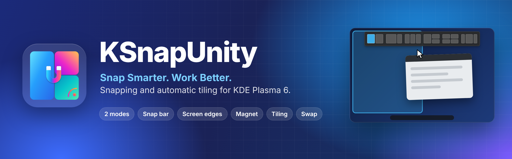

# SeaQ Snap Layout

🇬🇧 [English](README.md) · 🇩🇪 Deutsch

**Snap-Layouts für KDE Plasma 6. Zieh ein Fenster an den oberen Bildschirmrand, eine Leiste mit Layouts fährt herunter – leg das Fenster auf einer Zone ab, und es füllt genau diesen Bereich.**

**Vier Wege zum Einrasten:** Snap-Leiste, Bildschirmkanten mit intelligentem Füllen, ein Fenster-Magnet mit klebenden Kanten und 20 Tastenkürzel – jeder davon lässt sich einzeln ein- und ausschalten.

Ein reines KWin-Skript: kein zusätzliches Programm, kein Hintergrunddienst, nichts zu kompilieren.

[](LICENSE)


[Video](#-intro-video) · [Funktionen](#-funktionen) · [Weitere Wege](#-weitere-wege-zum-einrasten) · [Tastenkürzel](#%EF%B8%8F-tastenkürzel) · [Installation](#-installation) · [Anleitung](#-anleitung) · [Einstellungen](#%EF%B8%8F-einstellungen-im-überblick) · [FAQ](#-probleme--faq)

<br>

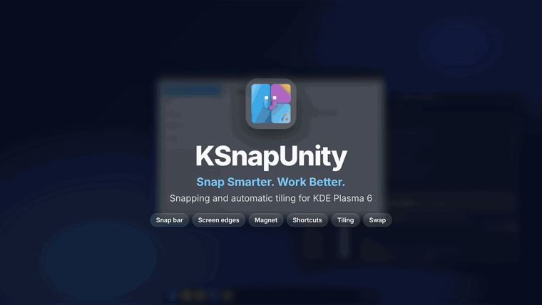

</div>

---

## 🎬 Intro-Video

<div align="center">

<a href="docs/video/seaq-snap-layout-intro.mp4">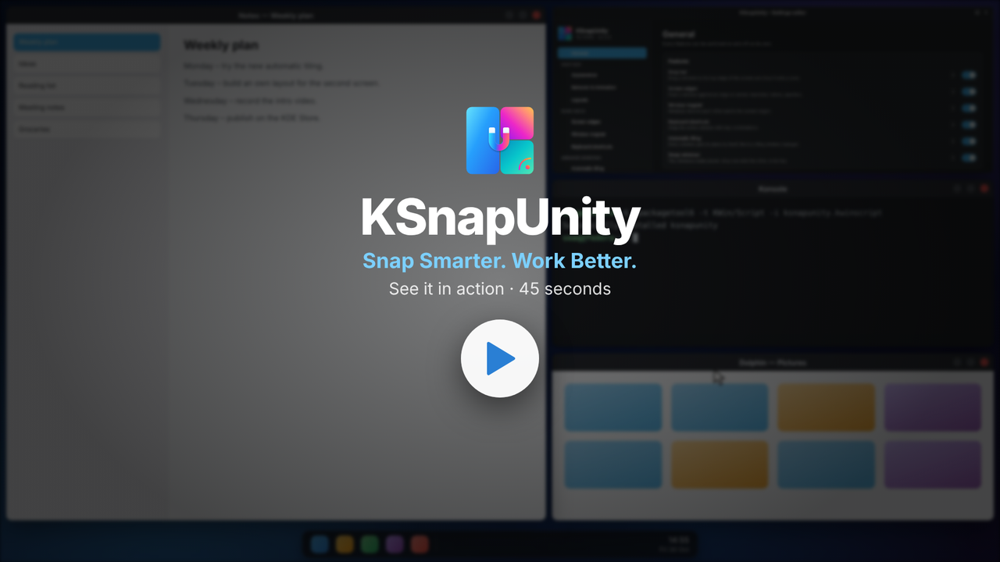</a>

<sub>34 Sekunden · zwei Fenster einrasten, die vier Wege zum Einrasten und die Farboptionen</sub>

</div>

---

## ⚡ So funktioniert's

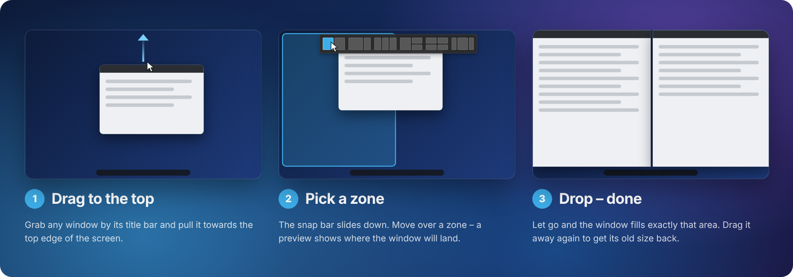

1. **Zieh** ein beliebiges Fenster an der Titelleiste zum oberen Rand. Zuerst erscheint ein kleiner Griff.
2. **Wähl eine Zone.** Die Snap-Leiste fährt herunter; die Zone unter dem Mauszeiger leuchtet auf, und eine Vorschau zeigt, wo das Fenster landet.
3. **Lass los.** Das Fenster füllt genau diese Zone. Ziehst du es wieder heraus, bekommt es seine alte Größe zurück.

---

## ✨ Funktionen

| | |
|---|---|
| 🪟 **Einrasten durch Ziehen** | Funktioniert mit der Mausbewegung, die du schon kennst – keine Tastenkürzel nötig. |
| ⇲ **Bildschirmkanten** | Drück ein Fenster gegen eine Kante oder Ecke: maximieren, Hälften, untere Hälfte, Viertel. Intelligentes Füllen lässt eingerastete Fenster frei. |
| ⏳ **Halten zum Auffüllen** | Kurzer Stoß = Hälfte oder Viertel. Etwas länger an der Kante halten – das Fenster wächst bis zum nächsten Fenster. |
| 🧲 **Fenster-Magnet** | Fenster haften beim Verschieben aneinander und an den Bildschirmrändern – kein Übereinanderrutschen. |
| 🔗 **Klebende Kanten** | Änderst du die Größe eines Fensters, gehen die berührenden Fenster mit: die gemeinsame Kante wandert mit, nichts überlappt, keine Lücke. Maus schütteln zum Lösen. |
| ⌨️ **Tastenkürzel** | 20 Aktionen – Hälften, Viertel, Drittel, zwei Drittel, maximieren, zentrieren, wiederherstellen. Sechs fertige Tastenschemata oder eigene Tasten. |
| 🔘 **Alles optional** | Snap-Leiste, Bildschirmkanten, Magnet und Tastenkürzel haben je einen eigenen Schalter. Vorschauen in der Akzentfarbe oder neutral – oder ganz aus. |
| 🤝 **Kein Doppel mit KDE** | KDEs eigenes Kanten-Kacheln (mit seinem Umriss) und seine Einrastzonen pausieren, solange das Skript läuft – deine KDE-Einstellungen bleiben unverändert. |
| 🧩 **Sechs Layouts, elf Vorlagen** | Hälften, zwei Drittel, drei Spalten, Haupt + Stapel, vier Viertel, Fokus Mitte – und Vorlagen wie sechs Kacheln oder Seitenleiste + Raster. |
| ✏️ **Layout-Designer** | Zonen nebeneinander oder übereinander teilen, Teiler ziehen – mit Einrasten bei ¼, ⅓ und ½. Bis zu 16 Zonen pro Layout. |
| ↕️ **Reihenfolge per Drag & Drop** | Layouts in der Leiste durch Ziehen der Karten umsortieren. Ausblenden, duplizieren oder löschen. |
| 🎨 **Deine Farben** | Snap-Leiste im System-, hellen oder dunklen Stil, deine Plasma-Akzentfarbe, zwölf Farbfelder oder jede Farbe vom Farbrad. |
| 📐 **Größe & Form** | Leistengröße, Breite der Vorschaubilder, Eckenradius, Deckkraft, mehrere Reihen, optionale Layout- und Zonennamen. |
| ⏱️ **Abgestimmte Bewegung** | Auslöseabstand, Griffabstand, Verzögerungen, Ausfahrweg, getrennte Ein-/Ausfahrdauer und sechs Bewegungskurven. Die Standardwerte orientieren sich an Windows 11. |
| 👁️ **Landevorschau** | Ein durchscheinendes Rechteck zeigt, wo das Fenster landet – inklusive Abständen und Leisten. |
| ↩️ **Größe zurück** | Ziehst du ein eingerastetes Fenster heraus, bekommt es seine vorherige Größe zurück. |
| 🚫 **Ausnahmen & Abstände** | Programme über ihre Fensterklasse ausnehmen; Abstände zwischen Fenstern und zum Bildschirmrand. |
| 🖥️ **Mehrere Bildschirme** | Die Leiste öffnet sich auf dem Bildschirm unter dem Mauszeiger, Zonen lassen Leisten frei. |
| 🌍 **62 Sprachen** | Editor und Schnellmenü folgen deiner Systemsprache, auch von rechts nach links. |
| 🧷 **Fühlt sich nativ an** | Der Einstellungseditor nutzt dein Farbschema, deine Akzentfarbe, Fensterdekoration (auch Aurorae-Designs) und Schrift – und passt sich live an. Knöpfe, Schalter und Schieberegler in deiner Akzentfarbe. |

---

## 🧭 Weitere Wege zum Einrasten

<table>
<tr>
<td align="center" width="50%">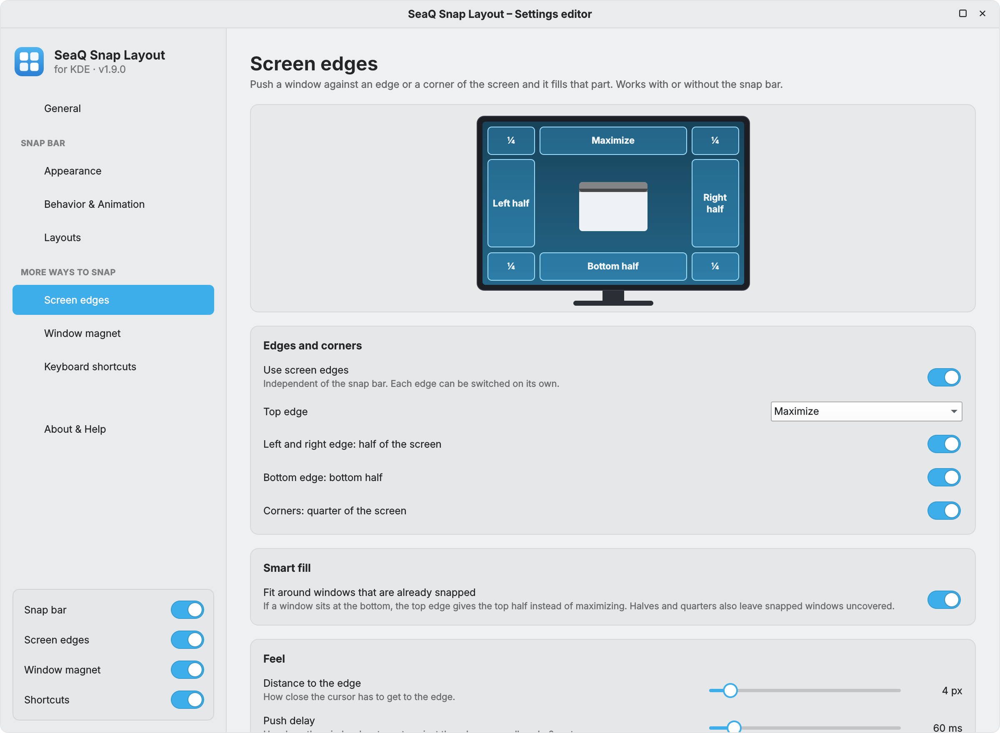<br><sub>Bildschirmkanten</sub></td>
<td align="center" width="50%"><br><sub>Fenster-Magnet</sub></td>
</tr>
</table>

### ⇲ Bildschirmkanten

Drück ein Fenster gegen eine Kante oder Ecke des Bildschirms, und es füllt diesen Teil aus – mit oder ohne Snap-Leiste.

| Wo | Ergebnis |
|---|---|
| Obere Kante | Maximieren (oder Vollbild · Obere Hälfte · Aus) |
| Mitte der linken / rechten Kante | Linke / rechte Hälfte |
| Untere Kante | Untere Hälfte |
| Ecken (äußere 20 % jeder Kante) | Viertel in dieser Ecke |

**Halten zum Auffüllen:** Ein kurzer Stoß gibt die Hälfte oder das Viertel. Hältst du das Fenster einen Moment länger an der Kante (standardmäßig 0,7 s), wächst es bis zum nächsten Fenster – zum Beispiel direkt neben ein Fenster, das das linke Drittel einnimmt. Die Vorschau zeigt es an, und danach liegen die Fenster aneinander, sodass die *klebenden Kanten* sie beim Größe-Ändern zusammenhalten.

**Intelligentes Füllen:** Liegt unten schon ein eingerastetes Fenster – auch nur ein Viertel –, füllt die obere Kante nur den Platz darüber, statt zu maximieren. Auch Hälften und Viertel überdecken nie eingerastete Fenster. Eine kurze **Andruck-Verzögerung** (60 ms) sorgt dafür, dass bloßes Vorbeifahren an einer Kante nichts auslöst.

Sind Snap-Leiste *und* obere Kante an, öffnet sich die Leiste wie gewohnt: Auf einer Zone ablegen nutzt das Layout, an der Kante außerhalb der Leiste ablegen nutzt die Aktion der oberen Kante.

### 🧲 Fenster-Magnet

Während du ein Fenster verschiebst oder seine Größe änderst, haften seine Kanten an nahen Fenstern und an den Bildschirmrändern. Ein Fenster **rutscht nicht über ein anderes**: Es bleibt an der Kante stehen und löst sich erst, wenn du es weiter hineinschiebst als der **Widerstand** (standardmäßig 48 px, 0 = aus). Einstellbar sind der **Einrastabstand** (2 – 64 px), getrennte Schalter für Fenster, Bildschirmränder und Größenänderung sowie die Option, den *Abstand zwischen Fenstern* zu halten, statt sie aneinanderzulegen.

### 🔗 Klebende Kanten

Fenster, die sich berühren, teilen sich ihre Kante. Änderst du die Größe eines davon, folgen die anderen live – nebeneinander, übereinander oder im Vierer-Raster:

- **Gemeinsame Kanten wandern mit** – der Abstand zwischen den Fenstern bleibt genau so, wie er war (auch mit *Abstand zwischen Fenstern*).
- **Gestapelte Fenster bleiben in einer Linie** – übereinanderliegende Fenster halten ihre linken und rechten Kanten zusammen, nebeneinanderliegende ihre oberen und unteren.
- **Nur echte Nachbarn** – die Fenster müssen sich auf einem Stück Kante gegenüberliegen; Kanten am Bildschirmrand werden nie gekoppelt.
- **Grenzen werden eingehalten** – ein Fenster wird nie kleiner als seine Mindestgröße und nie aus dem freien Bildschirmbereich geschoben.
- **Schütteln zum Lösen** – schüttle beim Größe-Ändern die Maus, und die anderen Fenster springen zurück.
- **Klare Rückmeldung** – Fenster, die nicht mitgehen, werden beim Größe-Ändern durchsichtig (abschaltbar).

Die Idee stammt aus dem KWin-Skript [Sticky Window Snapping](https://store.kde.org/p/1112552) von Toni Dietze; SeaQ Snap Layout hat eine eigene, neu geschriebene Umsetzung.

**KDEs eigene Helfer pausieren automatisch:** KDEs Kacheln an den Bildschirmkanten (mit seinem Umriss) und seine Einrastzonen würden auf dieselbe Bewegung reagieren. SeaQ Snap Layout pausiert sie, solange es läuft – ohne deine KDE-Einstellungen zu ändern. Schaltest du die Option aus, deaktivierst oder entfernst du das Skript, ist KDEs eigenes Verhalten wieder da (es wird nie in die `kwinrc` geschrieben).

> [!TIP]
> Beide Pausen-Schalter sind standardmäßig an. Schaltest du sie aus, reagieren Plasmas eigene Kanten-Kacheln und Einrastzonen wieder auf dieselbe Bewegung – der Editor zeigt dann einen orangen Hinweis.

---

## ⌨️ Tastenkürzel

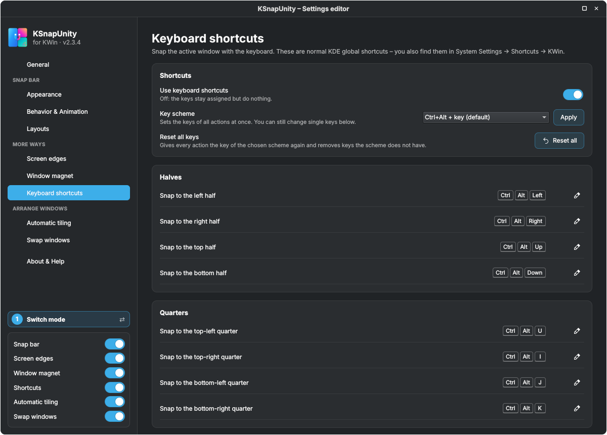

Die Tastenkürzel sind normale globale KDE-Kurzbefehle (*Systemeinstellungen* → *Kurzbefehle* → *KWin*, Suche „Snap Layout“). Auf der Seite **Tastenkürzel** kannst du

- ein **Tastenschema** wählen und auf alle Aktionen auf einmal anwenden,
- eine einzelne Aktion ändern: ein Klick auf eine **übliche Kombination** oder eine **eigene** aus Meta / Strg / Alt / Umschalt + Taste zusammenstellen,
- eine einzelne Aktion oder **alle Tasten** auf das gewählte Schema **zurücksetzen**,
- **bereits belegte Tasten** sehen und übernehmen – oder behalten.

| Aktion | Standard (Strg+Alt) | Meta-Schema | Ziffernblock-Schema |
|---|---|---|---|
| In die linke Hälfte | `Strg`+`Alt`+`Links` | `Meta`+`Links` | `Strg`+`Alt`+`Num+4` |
| In die rechte Hälfte | `Strg`+`Alt`+`Rechts` | `Meta`+`Rechts` | `Strg`+`Alt`+`Num+6` |
| In die obere Hälfte | `Strg`+`Alt`+`Hoch` | `Meta`+`Hoch` | `Strg`+`Alt`+`Num+8` |
| In die untere Hälfte | `Strg`+`Alt`+`Runter` | `Meta`+`Runter` | `Strg`+`Alt`+`Num+2` |
| Ins Viertel oben links | `Strg`+`Alt`+`U` | `Meta`+`U` | `Strg`+`Alt`+`Num+7` |
| Ins Viertel oben rechts | `Strg`+`Alt`+`I` | `Meta`+`I` | `Strg`+`Alt`+`Num+9` |
| Ins Viertel unten links | `Strg`+`Alt`+`J` | `Meta`+`J` | `Strg`+`Alt`+`Num+1` |
| Ins Viertel unten rechts | `Strg`+`Alt`+`K` | `Meta`+`K` | `Strg`+`Alt`+`Num+3` |
| Ins linke Drittel | `Strg`+`Alt`+`D` | `Meta`+`D` | – |
| Ins mittlere Drittel | `Strg`+`Alt`+`F` | `Meta`+`F` | – |
| Ins rechte Drittel | `Strg`+`Alt`+`G` | `Meta`+`G` | – |
| In die linken zwei Drittel | `Strg`+`Alt`+`E` | `Meta`+`E` | – |
| In die rechten zwei Drittel | `Strg`+`Alt`+`Y` | `Meta`+`Y` | – |
| Maximieren oder wiederherstellen | `Strg`+`Alt`+`Eingabe` | `Meta`+`Eingabe` | `Strg`+`Alt`+`Num+5` |
| Fenster zentrieren | `Strg`+`Alt`+`C` | `Meta`+`C` | `Strg`+`Alt`+`Num+0` |
| Größe von vor dem Einrasten wiederherstellen | `Strg`+`Alt`+`-` | `Meta`+`-` | – |
| Snap-Leiste an/aus | – | – | – |
| Bildschirmkanten an/aus | – | – | – |
| Fenster-Magnet an/aus | – | – | – |
| Snap-Leiste testen | – | – | – |

Die Schemata **Meta+Strg+Alt**, **Meta+Umschalt** und **Strg+Umschalt+Alt** nutzen dieselben Tasten mit diesen Zusatztasten. Das *Meta*-Schema ersetzt Plasmas eigene Kacheltasten (Meta+Pfeiltasten). Die vier An/Aus-Aktionen haben standardmäßig keine Taste.

> Im Editor stehen die Tasten so, wie KDE sie intern speichert (`Ctrl`, `Left`, `Return` …) – gemeint ist dasselbe wie hier (`Strg`, `Links`, `Eingabe` …).

---

## 🖼️ Vorschau

<div align="center">
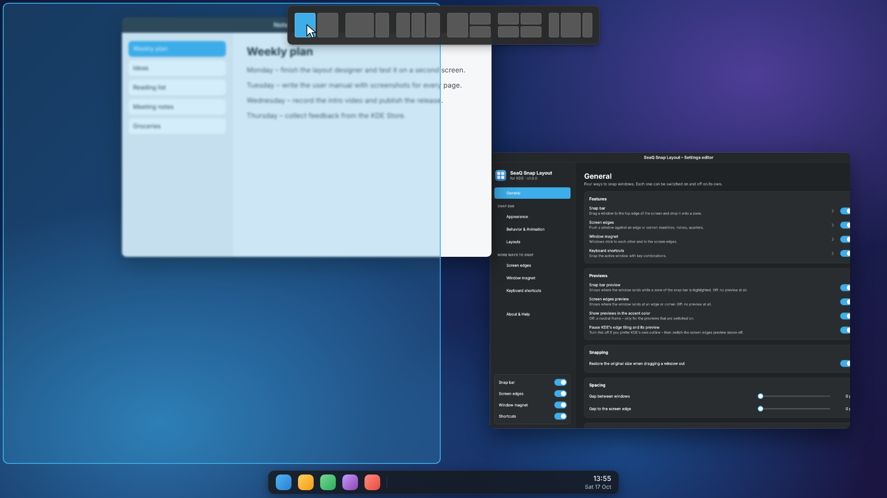
<sub>Die Snap-Leiste mit markierter Zone „Hälften – Zone 1“ und der Landevorschau links.</sub>
<br><br>
<table>
<tr>
<td align="center" width="50%">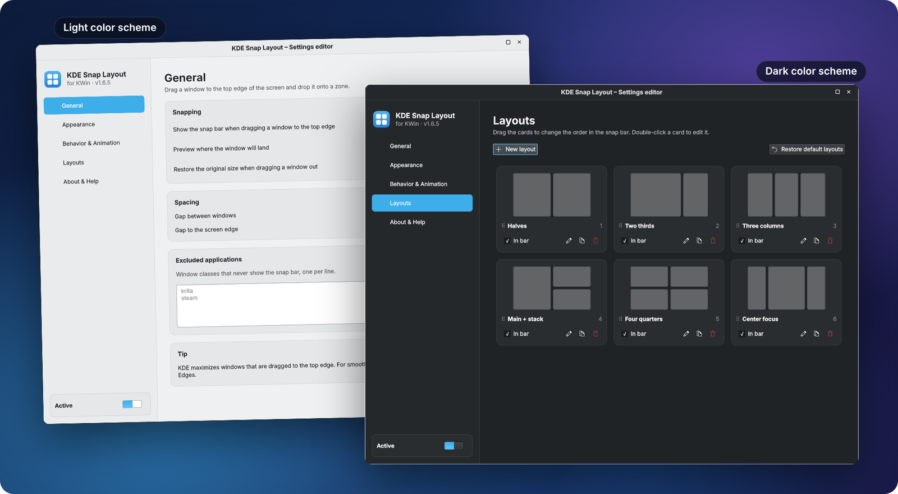<br><sub>Einstellungseditor – folgt deinem Farbschema</sub></td>
<td align="center" width="50%">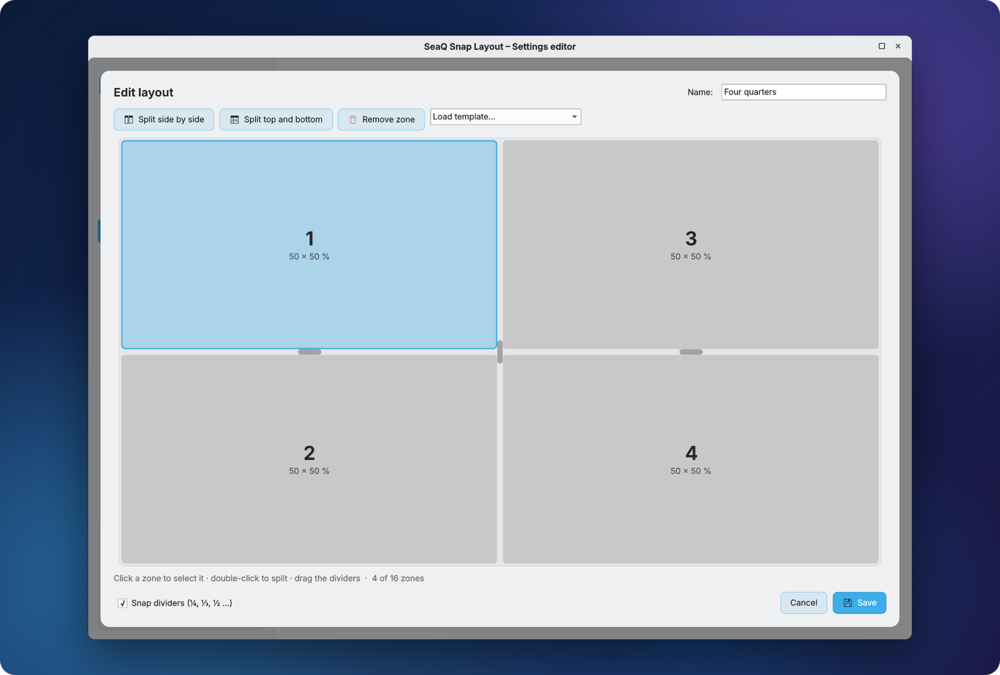<br><sub>Layout-Designer – teilen, anpassen, speichern</sub></td>
</tr>
<tr>
<td align="center">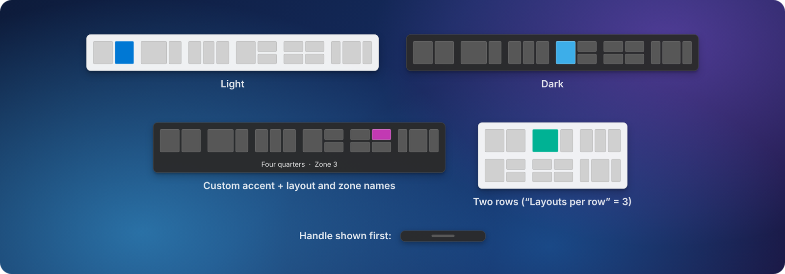<br><sub>Hell, dunkel, jede Akzentfarbe, Namen, mehrere Reihen</sub></td>
<td align="center">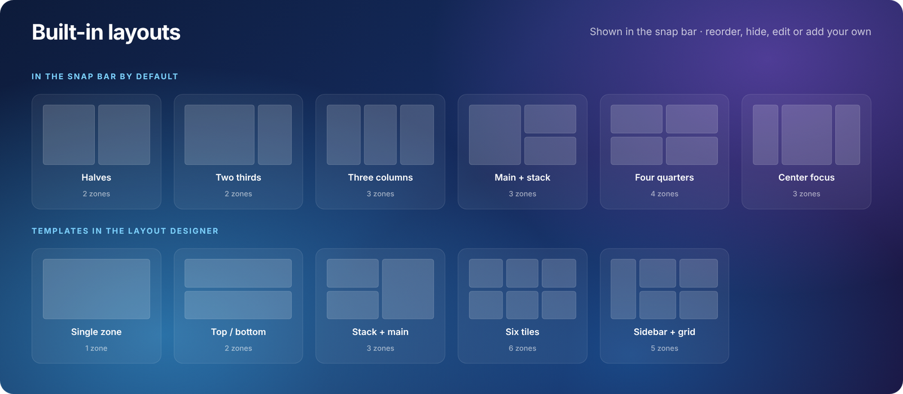<br><sub>Mitgelieferte Layouts und Vorlagen</sub></td>
</tr>
</table>
</div>

---

## 📦 Voraussetzungen

| | |
|---|---|
| Desktop | **KDE Plasma 6** (KWin 6) – Wayland oder X11 |
| Distribution | Beliebig – Fedora, Arch, openSUSE, KDE neon, Kubuntu, Debian … |
| Abhängigkeiten | Keine – alles ist in Plasma enthalten |

---

## 🚀 Installation

**Variante A – KDE Store (am einfachsten)**

*Systemeinstellungen* → *Fensterverwaltung* → *KWin-Skripte* → **Neue holen …** → nach **SeaQ Snap Layout** suchen → **Installieren**. Danach den Haken setzen und **Anwenden** klicken.

**Variante B – Datei von GitHub**

1. Lade **`kdesnaplayout-<version>.kwinscript`** von der Seite [**Releases**](../../releases/latest) herunter.
2. *Systemeinstellungen* → *Fensterverwaltung* → *KWin-Skripte* → **Aus Datei installieren …** → Datei auswählen.
3. Haken bei **SeaQ Snap Layout** setzen und **Anwenden** klicken.

**Variante C – Terminal**

```bash
kpackagetool6 --type KWin/Script --install kdesnaplayout-1.9.0.kwinscript   # Erstinstallation
kpackagetool6 --type KWin/Script --upgrade kdesnaplayout-1.9.0.kwinscript   # Update
kwriteconfig6 --file kwinrc --group Plugins --key kdesnaplayoutEnabled true
qdbus6 org.kde.KWin /KWin reconfigure
```

**Variante D – aus dem Quellcode**

```bash
git clone https://github.com/Swenix-dev/SeaQ-Snap-Layout.git
cd SeaQ-Snap-Layout
./build.sh                       # → dist/kdesnaplayout-<version>.kwinscript
./install.sh                     # optional: saubere Installation für die Entwicklung
```

> [!IMPORTANT]
> KWin behält ein geladenes Skript im Speicher. **Nach einem Update einmal ab- und wieder anmelden.** Die Version steht im Einstellungseditor auf der Seite *Info & Hilfe*.

> [!TIP]
> Plasmas eigene Kanten-Kacheln und Einrastzonen werden automatisch pausiert, solange SeaQ Snap Layout läuft – in den Systemeinstellungen musst du nichts ändern.

> [!NOTE]
> Der interne Name `kdesnaplayout` (Dateiname, Skript-ID, `~/.config/kde-snaplayout.ini`) bleibt absichtlich gleich – so behalten Updates deine Einstellungen und Tasten.

<details>
<summary><b>Deinstallieren</b></summary>

```bash
kpackagetool6 --type KWin/Script --remove kdesnaplayout
rm ~/.config/kde-snaplayout.ini      # optional: Einstellungen und Layouts löschen
```
</details>

---

## ⚙️ Einstellungen öffnen

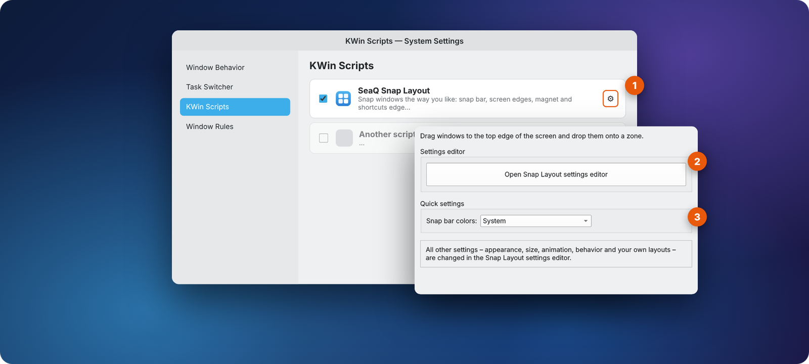

1. *Systemeinstellungen* → *Fensterverwaltung* → *KWin-Skripte* → **Zahnrad** neben *SeaQ Snap Layout*.
2. **Snap Layout Einstellungseditor öffnen** klicken (der Knopf wird in deiner Akzentfarbe gefüllt), dann **OK** – der Editor öffnet sich.
3. Im Schnellmenü kannst du außerdem die Farben der Snap-Leiste zwischen *System*, *Hell* und *Dunkel* umschalten.

---

## 📘 Anleitung

Eine vollständige, bebilderte Anleitung erklärt jede Seite und jede Einstellung – mit beschrifteten Bildschirmfotos, Grafiken zu allen Abständen und Bewegungskurven und einem Kapitel zur Fehlerbehebung.

<div align="center">

### [📥 Anleitung herunterladen (PDF, Deutsch)](docs/manual/SeaQ-Snap-Layout-Anleitung.pdf)

🇬🇧 [English manual (PDF)](docs/manual/SeaQ-Snap-Layout-Manual.pdf)

<sub>Die HTML-Quellen liegen in [`docs/manual/`](docs/manual/).</sub>

</div>

---

## 🎛️ Einstellungen im Überblick

<details open>
<summary><b>Allgemein</b></summary>

| Einstellung | Standard | Bereich |
|---|---|---|
| Snap-Leiste · Bildschirmkanten · Fenster-Magnet · Tastenkürzel | An | jeweils einzeln |
| Vorschau der Snap-Leiste · Vorschau der Bildschirmkanten | An | jeweils einzeln – aus bedeutet gar keine Vorschau |
| Vorschauen in der Akzentfarbe zeigen | An | aus = neutraler Rahmen |
| Ursprüngliche Größe beim Herausziehen wiederherstellen | An | |
| Abstand zwischen Fenstern | 0 px | 0 – 48 px |
| Abstand zum Bildschirmrand | 0 px | 0 – 48 px |
| Ausgenommene Anwendungen (Fensterklassen, eine pro Zeile) | – | |
</details>

<details>
<summary><b>Aussehen</b></summary>

| Einstellung | Standard | Bereich |
|---|---|---|
| Farbschema | System | System / Hell / Dunkel |
| Akzentfarbe des Systems verwenden | An | oder 12 Farbfelder / Farbrad |
| Größe der Snap-Leiste | 100 % | 60 – 200 % |
| Breite der Vorschaubilder | 72 px | 48 – 160 px |
| Eckenradius | 8 px | 0 – 24 px |
| Deckkraft des Hintergrunds | 96 % | 40 – 100 % |
| Layouts pro Reihe | 0 (eine Reihe) | 0 – 12 |
| Layout- und Zonennamen anzeigen | Aus | |
</details>

<details>
<summary><b>Verhalten & Animation</b></summary>

| Einstellung | Standard | Bereich |
|---|---|---|
| Auslöseabstand zum oberen Rand | 24 px | 2 – 200 px |
| Zuerst einen kleinen Griff zeigen | An | |
| Abstand, ab dem der Griff erscheint | 140 px | 20 – 400 px |
| Aktive Breite am oberen Rand | 100 % | 10 – 100 % |
| Verzögerung bis zum Ausfahren | 40 ms | 0 – 600 ms |
| Abstand, bis die Leiste wieder einfährt | 56 px | 0 – 300 px |
| Verzögerung bis zum Einfahren | 150 ms | 0 – 1000 ms |
| Wie weit die Leiste herunterfährt | 12 px | 0 – 150 px |
| Dauer beim Herunterfahren | 220 ms | 0 – 1000 ms |
| Dauer beim Zurückfahren | 150 ms | 0 – 1000 ms |
| Bewegungskurve | Sanft | Sanft · Zügig · Federnd · Dynamisch · Weich · Linear |
| Beim Ein- und Ausfahren überblenden | An | |
</details>

<details>
<summary><b>Bildschirmkanten</b></summary>

| Einstellung | Standard | Bereich |
|---|---|---|
| Bildschirmkanten verwenden | An | |
| Obere Kante | Maximieren | Maximieren · Vollbild · Obere Hälfte · Aus |
| Linke und rechte Kante: halber Bildschirm | An | |
| Untere Kante: untere Hälfte | An | |
| Ecken: Viertel des Bildschirms | An | |
| Intelligentes Füllen – an eingerastete Fenster anpassen | An | |
| Abstand zur Kante | 4 px | 1 – 40 px |
| Andruck-Verzögerung | 60 ms | 0 – 600 ms |
| Eckengröße | 20 % | 5 – 40 % |
| An der Kante halten, um den freien Platz zu füllen | An | |
| Haltezeit | 700 ms | 200 – 2000 ms |
| KDEs Kanten-Kacheln und dessen Vorschau pausieren | An | kommt zurück, wenn aus oder entfernt |
</details>

<details>
<summary><b>Fenster-Magnet</b></summary>

| Einstellung | Standard | Bereich |
|---|---|---|
| Fenster-Magnet verwenden | An | |
| Einrastabstand | 16 px | 2 – 64 px |
| Widerstand gegen Überlappen | 48 px | 0 – 200 px (0 = Fenster dürfen überlappen) |
| An anderen Fenstern haften | An | |
| An den Bildschirmrändern haften | An | |
| Auch beim Ändern der Größe | An | |
| Abstand zwischen Fenstern beibehalten | Aus | |
| **Klebende Kanten:** berührende Fenster gemeinsam in der Größe ändern | An | |
| Gestapelte Fenster in einer Linie halten | An | |
| Schütteln zum Lösen | An | |
| Andere Fenster ausblenden | An | |
| KDEs Einrastzonen pausieren, solange der Magnet an ist | An | kommt zurück, wenn aus oder entfernt |
</details>

<details>
<summary><b>Tastenkürzel</b></summary>

| Einstellung | Standard | Optionen |
|---|---|---|
| Tastenkürzel verwenden | An | aus = Tasten bleiben belegt, tun aber nichts |
| Tastenschema | Strg+Alt + Taste | Strg+Alt · Meta+Strg+Alt · Meta · Meta+Umschalt · Strg+Umschalt+Alt · Strg+Alt + Ziffernblock · keine |

Alle Tasten: siehe [Tastenkürzel](#%EF%B8%8F-tastenkürzel).
</details>

---

## 🗂️ Projektstruktur

```
SeaQ-Snap-Layout/
├── package/                    das KWin-Skript (wird installiert)
│   ├── metadata.json
│   └── contents/
│       ├── ui/                 main.qml (Logik), SnapBar, SettingsPage, LayoutEditor, …
│       ├── code/               layouts.js, edges.js, keys.js, i18n.js, translations.js (erzeugt)
│       ├── config/main.xml     Optionen des Schnellmenüs (kwinrc)
│       ├── locale/             .mo-Dateien für das Schnellmenü (erzeugt)
│       └── icons/
├── i18n/                       eine Textdatei pro Sprache + build.py
├── docs/                       Bilder, Video, Anleitungen (Englisch + Deutsch, PDF + HTML)
├── README.de.md                diese Datei
├── build.sh                    baut dist/kdesnaplayout-<version>.kwinscript
└── install.sh                  saubere Installation für die Entwicklung
```

---

## 🌍 Übersetzungen

Die Oberfläche folgt der Systemsprache. 62 Sprachen sind enthalten: alle europäischen Sprachen, Chinesisch (vereinfacht und traditionell), Japanisch, Koreanisch, Hindi, Bengalisch, Tamil, Telugu, Marathi, Gujarati, Punjabi, Urdu, Arabisch, Hebräisch, Persisch, Indonesisch, Malaiisch, Vietnamesisch, Thai, Filipino, Georgisch, Armenisch und mehr.

Jede Sprache ist eine einfache Textdatei in [`i18n/`](i18n) mit einer Zeile pro Text, in der Reihenfolge von `i18n/master.txt`. Um eine Übersetzung zu verbessern, bearbeite die Datei und führe aus:

```bash
python3 i18n/check.py      # Zeilenzahl und Platzhalter prüfen
python3 i18n/build.py      # erzeugt translations.js und die .mo-Dateien neu
```

Pull Requests mit Korrekturen oder neuen Sprachen sind sehr willkommen.

---

## ❓ Probleme & FAQ

<details>
<summary><b>Die Snap-Leiste erscheint nicht.</b></summary>

Prüfe, ob das Skript unter *KWin-Skripte* angehakt ist und der Schalter *Snap-Leiste* im Editor an ist. Das Programm darf nicht auf der Ausnahmeliste stehen, und es muss ein normales, in der Größe veränderbares Fenster sein, das an der Titelleiste gezogen wird.
</details>

<details>
<summary><b>Beim Ziehen an eine Kante passieren zwei Dinge gleichzeitig.</b></summary>

Plasmas eigene Kanten-Kacheln oder Einrastzonen sind aktiv. Schalte *KDEs Kanten-Kacheln und dessen Vorschau pausieren* (Seite Bildschirmkanten) und *KDEs Einrastzonen pausieren, solange der Magnet an ist* (Seite Fenster-Magnet) ein – beide sind standardmäßig an.
</details>

<details>
<summary><b>Ein Tastenkürzel tut nichts.</b></summary>

Prüfe den Schalter *Kürzel* und ob die Taste auf der Seite *Tastenkürzel* angezeigt wird. Ist die Taste anderweitig belegt, zeigt die Seite das an – übernimm sie oder wähle ein anderes Schema.
</details>

<details>
<summary><b>Ich habe aktualisiert, aber die alte Version läuft noch.</b></summary>

Melde dich einmal ab und wieder an. KWin behält geladene Skripte im Speicher.
</details>

<details>
<summary><b>Der Knopf im Schnellmenü tut nichts.</b></summary>

Nach **Snap Layout Einstellungseditor öffnen** musst du auf **OK** (oder **Anwenden**) klicken. Der Editor erscheint etwa eine Sekunde später.
</details>

<details>
<summary><b>Wie melde ich einen Fehler?</b></summary>

Öffne ein [Issue](../../issues) und füge das Protokoll bei:

```bash
journalctl --user -b | grep kdesnaplayout | tail -n 30
```
</details>

---

## ☕ Unterstützen

Wenn dir SeaQ Snap Layout gefällt, kannst du die Entwicklung unterstützen – danke! ♥

<p align="center">
<a href="https://paypal.me/SeaQSoft"></a>
<a href="https://buymeacoffee.com/seaq"></a>
</p>

---

## 📜 Lizenz

SeaQ Snap Layout ist freie Software unter der [GNU General Public License v3.0 oder neuer](LICENSE).

<div align="center">
<br>
Mit ❤️ für KDE gemacht von <a href="https://github.com/Swenix-dev"><b>SeaQ</b></a>
<br><br>
<sub>Wenn SeaQ Snap Layout deinen Tag ein bisschen aufgeräumter macht, hilft ein ⭐ auf GitHub anderen, es zu finden.</sub>
</div>
