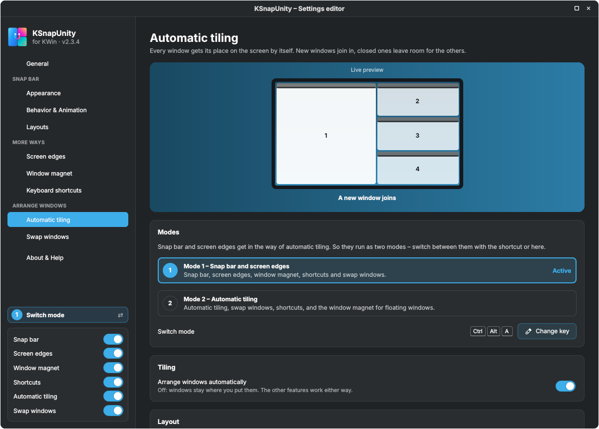
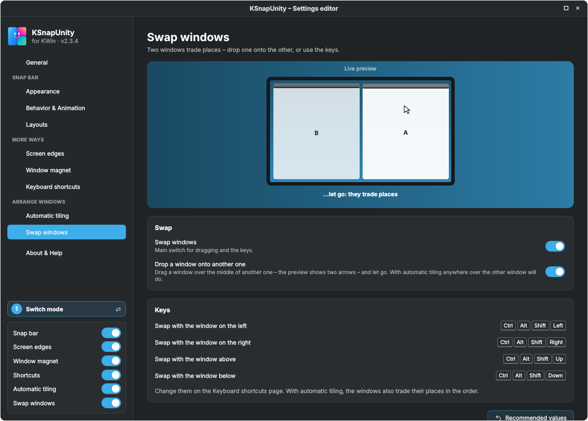
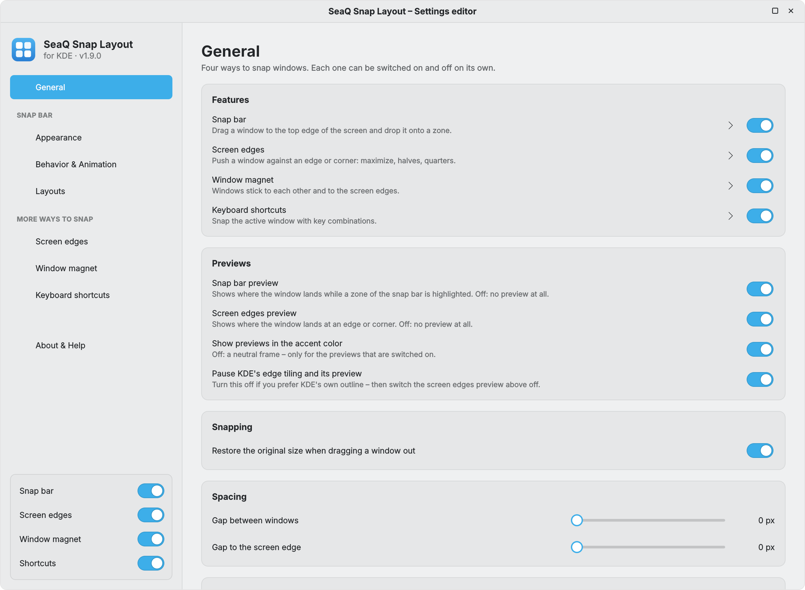
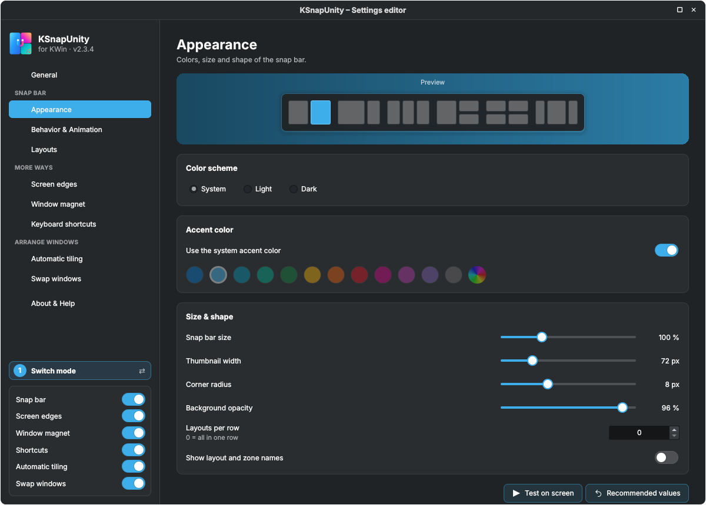
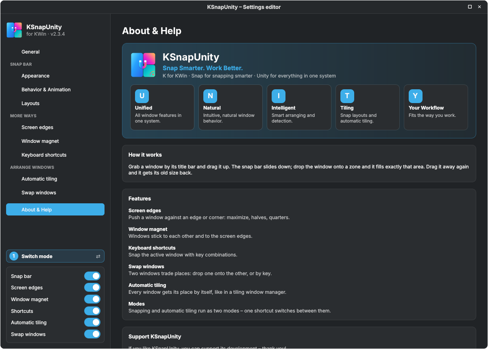

<div align="center">


# KSnapUnity

🇬🇧 English · 🇩🇪 [Deutsch](README.de.md)

### Snap Smarter. Work Better.

**2 modes, 6 features: smart snapping and automatic tiling for KDE Plasma 6 – in one KWin script.**

Drag a window to the top edge and drop it onto a zone of the snap bar – or let every window find its place by itself. One key (`Ctrl`+`Alt`+`A`) switches between both worlds.

[](LICENSE)


[Video](#-watch-the-intro) · [Two modes](#-two-modes) · [Features](#-six-features) · [Automatic tiling](#-automatic-tiling) · [Shortcuts](#%EF%B8%8F-keyboard-shortcuts) · [Installation](#-installation) · [Settings](#%EF%B8%8F-settings) · [FAQ](#-troubleshooting--faq)

<br>


</div>

---

## 🎬 Watch the intro

<div align="center">

<a href="docs/video/ksnapunity-intro-en.mp4"></a>

<sub>45 seconds · snap bar, mode switch, automatic tiling, swapping and the settings editor</sub><br>
<sub>🇩🇪 <a href="docs/video/ksnapunity-intro-de.mp4">German version</a></sub>

</div>

---

## 🧩 What does U.N.I.T.Y. stand for?

**K** for KWin · **Snap** for snapping smarter · **Unity** for everything in one system:

| | | |
|:-:|---|---|
| **U** | **Unified** | All window features in one system. |
| **N** | **Natural** | Intuitive, natural window behavior. |
| **I** | **Intelligent** | Smart arranging and detection. |
| **T** | **Tiling** | Snap layouts and automatic tiling. |
| **Y** | **Your Workflow** | Fits the way you work. |

A pure KWin script: no extra program, no background service, nothing to compile.

---

## 🔀 Two modes

Snapping by hand and automatic tiling would get in each other's way – so KSnapUnity runs them as **two modes**. Press **`Ctrl`+`Alt`+`A`**, click the mode badge in the settings or use the switch in the quick settings.

| | Mode 1 – Snap bar & screen edges | Mode 2 – Automatic tiling |
|---|---|---|
| **Idea** | You decide where a window goes | Every window gets its place by itself |
| **Snap bar** | ✅ | – |
| **Screen edges** | ✅ | – |
| **Window magnet** | ✅ | ✅ for floating windows |
| **Keyboard shortcuts** | ✅ snap keys | ✅ tiling keys, arrows move a window to its neighbour's place |
| **Swap windows** | ✅ drop over the middle of another window | ✅ drop anywhere over another window |

Both modes exist only when *Automatic tiling* **and** the snap bar or the screen edges are switched on. Otherwise just the one that is on runs, and the mode key does nothing.

---

## ✨ Six features

| | |
|---|---|
| 🪟 **Snap bar** | Drag a window by its title bar to the top edge. A bar with layouts slides down; drop the window onto a zone and it fills exactly that area. Drag it away again and it gets its old size back. |
| ⇲ **Screen edges** | Push a window against an edge or a corner: maximize, halves, bottom half, quarters. Hold it a moment longer and it grows up to the next window. |
| 🧲 **Window magnet** | Edges stick to other windows and to the screen edges – even when you move fast. Shared edges resize together (sticky edges). Shake the mouse or keep pushing to let go. |
| ⌨️ **Keyboard shortcuts** | Halves, quarters, thirds, maximize, center, swap and all tiling actions – every key can be changed right in the editor. |
| 🧱 **Automatic tiling** | Like Krohnkite or Polonium: main and stack, columns, grid, spiral, dwindle … or **your own layouts**. Windows glide smoothly to their place. |
| ⇄ **Swap windows** | Drop one window onto another – they trade places. Or press `Ctrl`+`Alt`+`Shift`+arrow. |

Every feature can be switched on and off on its own – in the sidebar of the settings editor or in the quick settings.

<table>
<tr>
<td width="50%"></td>
<td width="50%"></td>
</tr>
<tr>
<td align="center"><sub>Automatic tiling – with an animated live preview</sub></td>
<td align="center"><sub>Window magnet – sticky edges in action</sub></td>
</tr>
<tr>
<td width="50%"></td>
<td width="50%"></td>
</tr>
<tr>
<td align="center"><sub>Screen edges</sub></td>
<td align="center"><sub>Swap windows</sub></td>
</tr>
</table>

---

## 🧱 Automatic tiling

The best of Krohnkite and Polonium, in a settings editor you can click through:

- **Layouts:** main and stack, main in the middle, columns, rows, grid, spiral, dwindle, one at a time – **plus every layout you build in the layout builder**. Window 1 gets the biggest zone, more windows share the last zone; with fewer windows than zones *main and stack* is used, so no holes appear.
- **Layout by number of windows:** e.g. two windows side by side, from three main and stack, from five a grid (up to 6 rules, optional).
- **Main area:** size (also by dragging the main window's edge), number of main windows, main area on the left or right.
- **New windows** join at the end, take the main place or open next to the active window.
- **A single window** can stay centered with less width – great on ultrawide screens – and can ignore the outer margin.
- **Animation:** windows glide to their place instead of jumping; a new or restored window appears directly in its place.
- **Always floating:** pick open applications that are never arranged. Dialogs always float.
- **Close a window – no gap.** Minimize, close or float one and the others fill the space at once.

<details>
<summary><b>Tiling keys</b></summary>

| Key | Action |
|---|---|
| `Ctrl`+`Alt`+`N` | Next layout |
| `Ctrl`+`Alt`+`M` | Make it the main window |
| `Ctrl`+`Alt`+`O` | Float the window (leave tiling) |
| `Ctrl`+`Alt`+`.` / `,` | Main area bigger / smaller |
| `Ctrl`+`Alt`+`]` / `[` | One more / one less main window |
| `Ctrl`+`Alt`+arrows | Move the window to its neighbour's place (mode 2) |
</details>

---

## ⌨️ Keyboard shortcuts

Default scheme `Ctrl`+`Alt` (a keypad scheme is included as well). All keys are normal KDE global shortcuts – change them on the *Keyboard shortcuts* page of the editor or in *System Settings → Shortcuts → KWin*.

| Key | Action |
|---|---|
| `Ctrl`+`Alt`+`A` | **Switch mode** (snapping ⇄ automatic tiling) |
| `Ctrl`+`Alt`+`←` `→` `↑` `↓` | Left / right / top / bottom half |
| `Ctrl`+`Alt`+`U` `I` `J` `K` | Quarters (top left, top right, bottom left, bottom right) |
| `Ctrl`+`Alt`+`D` `F` `G` | Left / center / right third |
| `Ctrl`+`Alt`+`E` `Y` | Left / right two thirds |
| `Ctrl`+`Alt`+`Return` | Maximize or restore |
| `Ctrl`+`Alt`+`C` | Center the window |
| `Ctrl`+`Alt`+`-` | Restore the size before snapping |
| `Ctrl`+`Alt`+`Shift`+arrows | Swap with the neighbouring window |
| `Ctrl`+`Alt`+`N` `M` `O` `.` `,` `]` `[` | Tiling (see above) |

---

## 🚀 Installation

**Requirements:** KDE Plasma 6 (KWin 6), Wayland or X11, any distribution. No dependencies.

**Option A – KDE Store (easiest)**

*System Settings* → *Window Management* → *KWin Scripts* → **Get New…** → search **KSnapUnity** → **Install**. Tick it and click **Apply**.

**Option B – file from GitHub**

1. Download **`ksnapunity-<version>.kwinscript`** from the [**Releases**](../../releases/latest) page.
2. *System Settings* → *Window Management* → *KWin Scripts* → **Install from File…** → choose the file.
3. Tick **KSnapUnity** and click **Apply**.

**Option C – terminal**

```bash
kpackagetool6 --type KWin/Script --install ksnapunity-2.3.4.kwinscript   # first install
kpackagetool6 --type KWin/Script --upgrade ksnapunity-2.3.4.kwinscript   # update
kwriteconfig6 --file kwinrc --group Plugins --key kdesnaplayoutEnabled true
qdbus6 org.kde.KWin /KWin reconfigure
```

**Option D – from source**

```bash
git clone https://github.com/SeaQSoft/KSnapUnity.git
cd KSnapUnity
bash build.sh        # → dist/ksnapunity-<version>.kwinscript
bash install.sh      # optional: clean install for development
```

> [!IMPORTANT]
> KWin keeps a loaded script in memory. **After an update, log out and back in once.** The version is shown in the sidebar of the settings editor.

> [!NOTE]
> **Coming from SnapMagic, SeaQ Snap Layout or KDE Snap Layout?** KSnapUnity is the same script with a new name – the internal id stays `kdesnaplayout`, so updating keeps your settings, layouts and keys.

<details>
<summary><b>Uninstall</b></summary>

```bash
kpackagetool6 --type KWin/Script --remove kdesnaplayout
rm ~/.config/kde-snaplayout.ini      # optional: delete your settings and layouts
```
</details>

---

## ⚙️ Settings

### Quick settings

*System Settings* → *Window Management* → *KWin Scripts* → **gear icon** next to *KSnapUnity*.


Switch the mode, see the mode key, choose the snap bar colors and turn each feature on or off. **Open settings editor** → **OK** opens the full editor. Changes made here appear in the editor and the other way round.

### Settings editor



| Page | What you set there |
|---|---|
| **General** | All features at a glance, modes, previews, gaps between windows and to the screen edge |
| **Appearance** | Light, dark or system colors, accent color, size, roundness, layout names |
| **Behavior & Animation** | When the bar appears and hides, slide and fade animation, motion curve |
| **Layouts** | Order and visibility of the layouts, **layout builder** for your own layouts |
| **Screen edges** | Which edge does what, smart fill, hold to fill, KDE's own edge tiling |
| **Window magnet** | Snap distance, resistance, sticky edges, also while resizing |
| **Keyboard shortcuts** | Every key, key schemes, conflicts with other shortcuts |
| **Automatic tiling** | Layout, own layouts, layout by number of windows, main area, new windows, single window, animation, always floating |
| **Swap windows** | Drag to swap, swap keys |
| **About & Help** | Version, U.N.I.T.Y., how it works, support |

Every feature page has an **animated live preview** that shows what the feature does – with your settings.

<details>
<summary><b>More screenshots</b></summary>





</details>

---

## 🗂️ Project structure

```
KSnapUnity/
├── package/                    the KWin script (what gets installed)
│   ├── metadata.json
│   └── contents/
│       ├── ui/                 main.qml (logic), SnapBar, SettingsPage, Tiler, LiveDemo, config.ui, …
│       ├── code/               layouts.js, edges.js, tiling.js, keys.js, i18n.js, translations.js (generated)
│       ├── config/main.xml     options of the quick settings (kwinrc)
│       ├── locale/             .mo files for the quick settings (generated)
│       └── icons/
├── i18n/                       one text file per language + build.py / check.py
├── docs/                       images, videos, KDE Store texts
├── README.de.md                German README
├── build.sh                    builds dist/ksnapunity-<version>.kwinscript
└── install.sh                  clean install for development
```

---

## 🌍 Translations

The interface follows the system language. **62 languages** are included: all European languages, Chinese (simplified and traditional), Japanese, Korean, Hindi, Bengali, Tamil, Telugu, Marathi, Gujarati, Punjabi, Urdu, Arabic, Hebrew, Persian, Indonesian, Malay, Vietnamese, Thai, Filipino, Georgian, Armenian and more.

Each language is a plain text file in [`i18n/`](i18n) with one line per text, in the order of `i18n/master.txt`. To improve a translation, edit the file and run:

```bash
python3 i18n/check.py      # line counts and placeholders
python3 i18n/build.py      # regenerates translations.js and the .mo files
```

Pull requests with corrections or new languages are very welcome.

---

## ❓ Troubleshooting & FAQ

<details>
<summary><b>The snap bar does not appear.</b></summary>

Check that the script is ticked in *KWin Scripts*, that you are in **mode 1** and that *Snap bar* is on. The window must be a normal, resizable window dragged by its title bar.
</details>

<details>
<summary><b>The mode key does nothing.</b></summary>

Both modes need *Automatic tiling* and the snap bar or the screen edges switched on. The quick settings show which key is set. After the update from an older version the key moves once from `Ctrl`+`Alt`+`Space` to `Ctrl`+`Alt`+`A` – a key you chose yourself stays.
</details>

<details>
<summary><b>Automatic tiling moves a window I want to keep where it is.</b></summary>

Press `Ctrl`+`Alt`+`O` (*Float the window*), or add the application under *Always floating* on the tiling page.
</details>

<details>
<summary><b>Windows let go of each other too easily – or not easily enough.</b></summary>

Change *Resistance against overlapping* on the *Window magnet* page. To let go on purpose, shake the mouse quickly or keep pushing for a moment.
</details>

<details>
<summary><b>Two things happen when I drag a window to an edge.</b></summary>

Plasma's own edge tiling or snap zones are active. Keep *Pause KDE's edge tiling and its preview* (General page) and *Pause KDE's snap zones while the magnet is on* (Window magnet page) switched on – both are on by default. Your KDE settings are not changed.
</details>

<details>
<summary><b>I can't type into a text field of the editor.</b></summary>

The editor is a window of KWin itself, and KWin gives its own windows no keyboard focus. That is why lists are picked with the mouse (e.g. *Always floating* → *Add an open application*).
</details>

<details>
<summary><b>I updated, but the old version is still running.</b></summary>

Log out and back in once. KWin keeps loaded scripts in memory.
</details>

<details>
<summary><b>How do I report a bug?</b></summary>

Open an [issue](../../issues) and include the log:

```bash
journalctl --user -b | grep kdesnaplayout | tail -n 30
```
</details>

---

## ☕ Support

If you like KSnapUnity, you can support its development – thank you! ♥

<p align="center">
<a href="https://paypal.me/SeaQSoft"></a>
<a href="https://buymeacoffee.com/seaq"></a>
</p>

---

## 📜 License

KSnapUnity is free software, licensed under the [GNU General Public License v3.0 or later](LICENSE).

<div align="center">
<br>
Made with ❤️ for KDE by <a href="https://github.com/SeaQSoft"><b>SeaQ</b></a>
<br><br>
<sub>If KSnapUnity makes your desktop a little tidier, a ⭐ on GitHub helps others find it.</sub>
</div>
